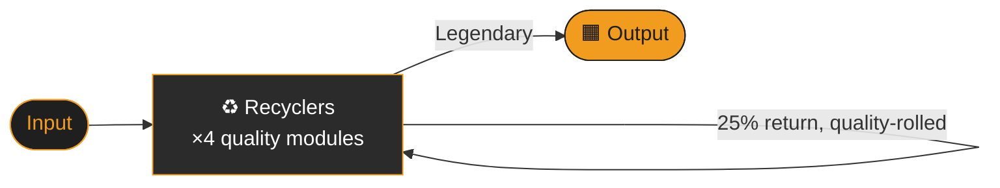
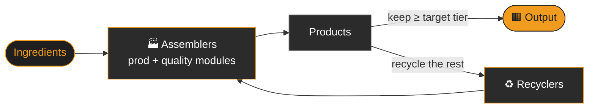

<div align="center">

# ⚙️ Factorio Quality Loop Simulator

**Model your quality-upcycling builds *before* you place a single belt.**


*A small Python toolkit for the Factorio: Space Age quality system.*

[Quick start](#-quick-start) •
[How it works](#-how-it-works) •
[Loops](#-the-loops) •
[Examples](#-worked-examples) •
[API](#-api-reference) •
[Development](#-development)

</div>

---

## 📖 What is this?

In Factorio: Space Age, **quality modules** give a machine a chance to bump its product up a tier
(Normal → Uncommon → Rare → Epic → Legendary). Getting Legendary items in bulk means feeding the
output back through **recyclers** again and again, and the numbers get messy quickly:

- How many Legendary items per hour will this build actually make?
- Which tier is the bottleneck, and how many machines does it need?
- Is it worth putting productivity modules in the assemblers, or should they all be quality?

This repo answers those questions by **simulating the loop as a Markov-style flow process**.
You describe your machines, modules and input rate, and it iterates the loop until nothing is left
in the system. It returns the steady-state flow at every tier, plus the total crafting time and a
per-tier "max flow" so you can see what to scale up.

## 🚀 Quick start

This project uses [`uv`](https://docs.astral.sh/uv/) for everything.

```bash
git clone https://github.com/benmol1/factorio.git
cd factorio
uv sync                 # create the venv and install dependencies

uv run python -m src.quality.pure_recycler_loop         # run the recycler-only demo
uv run python -m src.quality.assembler_recycler_loop    # run the assembler + recycler demo
uv run pytest                                           # run the test suite
```

### 🖥️ Web frontend

```bash
uv run uvicorn src.web.app:app --reload   # then open http://127.0.0.1:8000
```

Pick machines, module tiers and qualities in game terms. The app works out speeds, quality chances and
productivity for you, then shows flows per tier split into ingredients and products, with bottlenecks
highlighted. The README's worked examples are built in as presets. Game graphics are © Wube Software.

On the assembler → recycler tab you can:

- **Pick a recipe** from the built-in library. It fills in the crafting time and limits the machine
  list to machines that can craft it. Choose **Custom** to enter your own time and ratio.
- **Choose the critical ingredient.** The loop tracks one ingredient, usually the one with the highest
  input flow or the one that's hardest to make. It defaults to the largest amount in the recipe, and
  the products-per-ingredient ratio is derived from your choice. A hint shows how much of the other
  ingredients each one needs; those are assumed to be supplied separately at matching quality.
- **Set machine quality per ingredient tier**, so you can mix, say, legendary machines in the low
  tiers with normal ones higher up.
- **Solve for machine counts.** Press **Solve** and for each
  stage it picks the fewest machines that leave no bottleneck (the footprint comes first), then the lowest machine
  quality that still needs no more of them, so machines are as loaded as possible without exceeding 100%. It fills
  in the counts and qualities.
  The library function is [`solve_machine_counts`](src/quality/solver.py).

For example, toolbelt equipment with carbon fiber as the critical ingredient, 100 Normal carbon fiber/s,
48/6/2/2/1 assembling machine 3s (Legendary for the first three tiers, Normal after), 4 quality
modules each and 10 Legendary recyclers gives **≈19.4 legendary carbon fiber per minute**.

#### Adding recipes

Recipes live in [`src/web/recipes.py`](src/web/recipes.py), with data from the
[Factorio wiki](https://wiki.factorio.com). Add any new items to `ITEMS`, drop a 64×64 icon in
`src/web/static/icons/`, and add a `Recipe` with its time, ingredients, products and the `MACHINES`
keys that can craft it:

```python
"toolbelt-equipment": Recipe(
    "Toolbelt equipment",
    time=10,
    ingredients={"advanced-circuit": 3, "carbon-fiber": 10},
    products={"toolbelt-equipment": 1},
    machines=ASSEMBLERS,
),
```

Current recipes: carbon fiber, toolbelt equipment, pipe, pipe to ground (assembler and foundry casting), fast underground belt, low density structure (assembler and foundry casting), electromagnetic plant and coal synthesis.

> [!NOTE]
> Run the demos as modules (`python -m ...`) from the repo root, because the code imports from `src.quality`.

## 🧠 How it works

### 1. Quality tiers

There are five tiers, held in the `QualityTier` enum and indexed `0`–`4`:

| # | Tier | Colour |
|:-:|------|:------:|
| 0 | Normal    | ⬜ |
| 1 | Uncommon  | 🟩 |
| 2 | Rare      | 🟦 |
| 3 | Epic      | 🟪 |
| 4 | Legendary | 🟧 |

### 2. The quality transition matrix

For a machine with total quality chance `q`, an item of tier *i* becomes tier *o* with probability:

| Case | Probability |
|------|-------------|
| `o < i` | `0`, since items are never downgraded |
| `i = o` | `1 − q` |
| `i = Legendary` | `1`, since it is the top tier and stays there |
| `o = i + 1` (not Legendary) | `0.9 · q` |
| `o = i + k`, `k > 1` (not Legendary) | `0.9 · q / 10^(k−1)` |
| `o = Legendary` (from below) | `q / 10^(3−i)`, the leftover tail probability |

`quality_matrix(q)` builds the full 5×5 matrix of these. Multiplying each row by a **production
ratio** (productivity bonus for assemblers, 0.25 return rate for recyclers) gives the
*production matrix* the simulation uses.

### 3. Iterating the loop

A flow vector `f` (items/second at each tier) is pushed through the transition matrix `T` over and
over:

```
f₀ = input        f₁ = f₀ · T        f₂ = f₁ · T        …        stop when Σ|fₙ − fₙ₊₁| < ε
```

The **total flow** through each tier is the sum of all the `fₙ`. Tiers you *keep* act as sinks (an
all-zero row in the matrix), so that is where finished items accumulate.

## 🏭 The loops

### Pure recycler loop

Recyclers feeding themselves, with no assemblers. It's ideal for things that already exist as an
item you can recycle, such as ores, eggs and scrap.



Module: [`pure_recycler_loop.py`](src/quality/pure_recycler_loop.py)

- Takes an optional `recycle_time` (see [Recycle time](#-recycle-time-and-factorio-21)) for items whose recycling recipe isn't the usual 1/16 of the crafting time.
- `get_production_rate` converts raw flows into numbers comparable with the **in-game production statistics panel**.
  The game only counts item-created and item-destroyed events, so an item that is recycled into itself never shows up.

### Assembler → recycler loop

Craft an item, recycle it, and feed the ingredients back to the assemblers. Quality gets rolled on both the craft and the recycle.



Module: [`assembler_recycler_loop.py`](src/quality/assembler_recycler_loop.py)

The state is a **10-element vector**: 5 ingredient tiers (`I1`–`I5`) followed by 5 product tiers
(`P1`–`P5`). The 10×10 transition matrix puts the assembler matrix in the top-right block and the
recycler matrix in the bottom-left block, so each iteration alternates between crafting and recycling.

You can set a different **module mix per tier** (e.g. all-quality in low tiers, all-productivity at
the top) and choose independently which tier to extract for ingredients and for products.

## 🧪 Worked examples

### ♻️ Tungsten ore through a pure recycler loop

45 Normal + 15 Uncommon ore per second, 5 legendary recyclers (speed 1) with 4 quality modules (24.8% quality):

```python
import numpy as np
from src.quality.pure_recycler_loop import recycler_loop, get_production_rate

input_vector = np.array([45.0, 15.0, 0.0, 0.0, 0.0])

flows, transition_matrix, total_crafting_time = recycler_loop(
    input_vector=input_vector,
    quality_chance=4 * 0.062,
    recipe_time=1,
    num_recyclers=5,
    speed_recycler=1,
)

rates = get_production_rate(input_vector, flows, transition_matrix)
print(f"Legendary per hour: {rates[4] * 3600:.1f}")
```

```text
## Flow per second:
[55.42 22.28  1.91  0.32  0.05]
## Production rates per minute:
[2700.   1085.54   93.15   15.72    2.95]
## Legendary production rate per hour: 176.8
## Total crafting time: 1.00 seconds
```

### 🏭 Legendary U-238 via uranium ammo

The demo in [`assembler_recycler_loop.py`](src/quality/assembler_recycler_loop.py) uses a
quality-only module setup in the low tiers, 8 Normal ingredients/s in, legendary assemblers and
recyclers, and a mix of machine counts per tier. It prints how loaded each tier is against its
theoretical maximum:

```text
## Flow per second:
[ 9.32  0.91  0.32  0.09  0.03 10.63]
## Max flow per second:
[10.    1.    0.5   0.25  0.1  12.8 ]

## Flows over max:
[0.93 0.91 0.63 0.36 0.26 0.83]
```

Any ratio above `1.0` means that tier is the bottleneck and the demo prints which tiers need more machines.

## 📚 API reference

### `src.quality` (shared)

| Name | Description |
|------|-------------|
| `NUM_TIERS` | Number of quality tiers (`5`). |
| `BEST_PROD_MODULE` | Best productivity module bonus (`0.25`). |
| `BEST_QUAL_MODULE` | Best quality module bonus (`0.062`). |
| `QualityTier` | `IntEnum` of the five tiers. |
| `quality_probability(q, in_tier, out_tier)` | Probability of one tier upgrading to another. |
| `quality_matrix(q)` | 5×5 transition matrix for quality chance `q`. |
| `create_production_matrix(params)` | 5×5 matrix from five `(quality_chance, production_ratio)` tuples, one per row. |

### `src.quality.pure_recycler_loop`

| Function | Returns |
|----------|---------|
| `recycler_loop(input_vector, quality_chance, quality_to_keep=5, speed_recycler=0.4, num_recyclers=1, recipe_time=1.0, recipe_ratio=1.0, recycle_time=None, verbose=False)` | `(flows, transition_matrix, total_crafting_time)` |
| `recycler_matrix(quality_chance, quality_to_keep=5)` | 5×5 recycler production matrix (cached). |
| `get_production_rate(input_vector, output_flows, transition_matrix)` | Per-tier production rate as shown by the game's stats panel. |

### `src.quality.assembler_recycler_loop`

| Function | Returns |
|----------|---------|
| `assembler_recycler_loop(input_vector, assembler_modules_config, product_quality_to_keep, ingredient_quality_to_keep, base_prod_bonus, recipe_ratio, recipe_time, speed_assemblers, speed_recycler, num_assemblers, num_recyclers, recycle_time, …)` | `(flows, transition_matrix, total_crafting_time, max_flow_vector)` |
| `get_assembler_parameters(...)` / `get_recycler_parameters(...)` | Per-tier `(quality_chance, production_ratio)` lists. |
| `create_transition_matrix(assembler_matrix, recycler_matrix)` | The combined 10×10 matrix. |
| `create_crafting_time_vector(...)` / `create_max_flow_vector(...)` | Per-tier crafting times and max throughputs. |

<details>
<summary><b>Module configuration cheat-sheet</b> (click to expand)</summary>

`assembler_modules_config` is either a single `(productivity_modules, quality_modules)` tuple
applied to every tier, or a list of five such tuples, one per tier. For a 4-slot machine:

```python
n_slots = 4
full_qual_config = [(0, n_slots)] * 4 + [(n_slots, 0)]  # quality everywhere, prod at the top
full_prod_config = [(n_slots, 0)] * 5  # productivity everywhere
optimal_leg_config = [(n_slots - 1, 1)] * 4 + [(n_slots, 0)]  # 3 prod + 1 qual below legendary
```

`product_quality_to_keep` / `ingredient_quality_to_keep` set the **lowest tier that gets extracted**
instead of being recycled or re-assembled. `None` means "never extract" (recycle or assemble everything).

</details>

## 🆕 Recycle time and Factorio 2.1

Up to Factorio 2.1.12, an item's recycling recipe took 1/16 of its crafting time, and that is still the default here
(`recycle_time=None` means `recipe_time / 16`). From **2.1.13**, recycle time scales with the item's result count, so
for some items (concrete is about 10× faster) the 1/16 rule is wrong. Pass the base time of the item's recycling
recipe from the game as `recycle_time` to get accurate crafting times and bottleneck figures. Flows and quality
probabilities are unaffected, only the timing.

> [!WARNING]
> Factorio 2.1.7 stopped quality modules working in asteroid reprocessing, so asteroid crushers can no longer be
> used as a quality-upcycling loop. Crusher support (`is_asteroid_crusher`) has been removed.

## 🛠️ Development

```bash
uv sync                      # install runtime + dev dependencies
uv run pytest                # tests
uv run ruff format .         # format
uv run ruff check . --fix    # lint
```

Layout:

```text
factorio/
├── src/quality/
│   ├── utils.py                    # tiers, constants, probability + production matrices
│   ├── pure_recycler_loop.py       # recycler-only loop simulation
│   └── assembler_recycler_loop.py  # assembler → recycler loop simulation
├── src/web/
│   ├── app.py                      # FastAPI app + JSON API
│   ├── game_data.py                # machine/module stats (game terms → simulation inputs)
│   ├── recipes.py                  # recipe + item library from the Factorio wiki
│   └── static/                     # single-page frontend + Wube icons
├── tests/
│   ├── test_utils.py
│   ├── test_loops.py
│   └── test_web.py
├── pyproject.toml                  # project metadata, ruff + pytest config
└── uv.lock
```

## ⚠️ Caveats

- The simulation works on **average flows**. It models steady-state throughput, not item-by-item randomness or belt and inserter limits.
- For recipes with several ingredients, only the **critical ingredient** is simulated. The others are assumed to be available at the right quality, even though recycling returns them too.
- Machine speeds, module counts and the 16× recycler speed bonus are inputs and assumptions you provide. Check them against your own game version.

---

<div align="center">

*The factory must grow, and so must its quality.* 🟧

</div>
