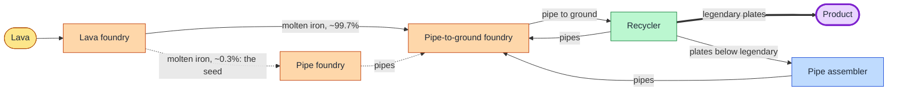

# How the pipe chain and its optimiser work

This explains `src/quality/pipe_chain.py`: how it turns free lava into legendary iron plates, and how
`optimise()` finds the best module setup for a fixed number of machines. All numbers below come from the code's
recipe data (see "Things to double-check" at the end) and from the actual solver output.

Run it with `uv run -m src.quality.pipe_chain`.

## 1. The idea in one picture

Only **legendary iron plates** leave the system. Everything else goes round again, and each trip through a machine
with quality modules has a chance to bump items up a tier. Eventually almost everything that is still circulating is
a high tier, and a steady stream of legendary plates drops out.

## 2. The recipes (per craft)

| Step | In | Out | Time |
|---|---|---|---|
| Lava foundry | 500 lava | 250 molten iron + 10 stone | 16 s |
| Cast pipe | 10 molten iron | 1 pipe | 1 s |
| Cast pipe to ground | 10 pipes + 50 molten iron | 2 pipe to ground | 1 s |
| Recycle pipe to ground | 1 pipe to ground | 1.25 pipes + 0.625 iron plates (on average) | see below |
| Assemble pipe | 1 iron plate | 1 pipe | 0.5 s |

The recycler returns 25% of the ingredients of the recipe it reverses. The recipe makes 2 pipe to ground from
10 pipes + 5 plates, so 1 pipe to ground gives back 25% x (10 / 2) = 1.25 pipes and 25% x (5 / 2) = 0.625 plates.

Two things multiply what comes out of a machine:

- **Foundries have a built-in +50% productivity**. So 500 lava gives 250 x 1.5 = 375 molten iron.
- **Productivity modules** add +25% each (level 3), so 4 of them add +100%. They also slow the machine by 15% each.

## 3. Quality in simple terms

A machine with 4 quality modules has a 4 x 6.2% = **24.8% quality chance**. Each craft rolls once:

- 75.2% of the output stays at the input's tier.
- Of the 24.8% that upgrades, 90% goes up one tier, 9% of that goes up two, and so on (each extra tier is 10x rarer).
- Items already legendary can't go higher, so they just stay.

For items coming in at **normal**, the outputs are:

| Normal | Uncommon | Rare | Epic | Legendary |
|---|---|---|---|---|
| 75.2% | 22.3% | 2.2% | 0.22% | 0.02% |

For items coming in at **epic** it is 75.2% epic and 24.8% legendary. That's why epic items are the "waiting room"
for legendary.

## 4. Following one pipe around the loop

Take a **legendary** pipe and a setup with 4 productivity modules in the pipe-to-ground foundry and in the plate
assembler (no quality modules). The pipe-to-ground foundry multiplier is 1 + 0.5 (built in) + 1.0 (modules) = 2.5, and
the assembler multiplier is 1 + 0 + 1.0 = 2.0.

1. 1 pipe goes into the pipe-to-ground foundry. Normally 10 pipes make 2 pipe to ground, so 1 pipe makes 0.2.
   With the 2.5x multiplier that's **0.5 pipe to ground**.
2. The recycler turns 0.5 pipe to ground into 0.5 x 1.25 = **0.625 pipes** and 0.5 x 0.625 = **0.3125 plates**.
3. The 0.625 pipes go straight back into step 1.
4. The 0.3125 plates are legendary, so they **leave as product**.

So at the legendary tier the loop always shrinks (each trip brings back only 0.625 of the pipes). That's what keeps
the numbers finite.

At lower tiers the plates are not products. They go into the pipe assembler:

1. 0.3125 plates x 2.0 (assembler productivity) = **0.625 more pipes**, which go back to step 1.

So a lower-tier pipe comes back as 0.625 + 0.625 = **1.25 pipes per trip**. That's more than 1 only because
productivity modules create extra items. What stops it growing without limit is that quality rolls move items up
tiers, and the top tier leaks plates out of the loop.

## 5. Solving the steady state: "x = x0 + x T"

Instead of simulating until things settle, the code solves for the settled state directly.

- Track the flow (items/s) of pipes, pipe to ground and plates at each of the 5 tiers: 15 numbers, the vector `x`.
- `T` is a 15x15 table saying "if 1 item/s of this arrives, this much of each other item/s leaves the next machine,
  per tier". Each entry is (the quality probability) x (the recipe ratio from section 4).
- `x0` is the fresh input: the pipes cast from molten iron by the pipe foundry (10 molten iron per pipe).
- In steady state, what arrives is the fresh input plus what the loop sends round: `x = x0 + x T`.
- Rearranged: `x = x0 (I - T)^-1`. One matrix inverse, no iteration.

The answer is computed for 1 molten iron/s into the pipe foundry, and then scaled so total molten iron demand matches
what the lava foundries can make.

### Example (the 10-machine optimum, lava = 221 per second)

Flows per second, by tier (normal, uncommon, rare, epic, legendary):

| Item | Normal | Uncommon | Rare | Epic | Legendary |
|---|---|---|---|---|---|
| Pipes into pipe-to-ground foundries | 0.12 | 0.87 | 4.13 | 19.63 | 8.29 |
| Pipe to ground recycled | 0.06 | 0.43 | 2.07 | 9.81 | 4.14 |
| Plates out of recyclers | 0.03 | 0.21 | 1.03 | 4.91 | **4.14** |

Check it with section 4's arithmetic: legendary pipes 8.29 x 0.5 = 4.14 legendary pipe to ground. Then 4.14 plates
from legendary pipe to ground is: 4.14 x 0.625 = 2.59 from legendary, plus 9.81 x 0.625 x 24.8% = 1.52 from epic
pipe to ground whose recycler roll upgraded, plus about 0.03 from rare. Total = **4.14 legendary plates/s**.

Most of the material sits at epic tier (19.6 pipes/s), waiting for the 24.8% roll that sends it to legendary.

### Almost all the molten iron goes into pipe-to-ground, not pipes

The pipe foundry only seeds the loop. The loop is close to self-sustaining (a lot of pipes come from re-assembled
plates), so the pipe foundry gets only about 0.3% of the molten iron. The other 99.7% is the 50 molten iron per pipe-to-ground craft.
Rough multiplier: about 590 pipes circulate for every pipe the pipe foundry casts.

## 6. Counting machines

Each machine type needs `(items per second) x (craft time) / (machine speed)` machines. Speed is the base speed times
(1 - module slowdown). Quality modules slow a machine by 5% each, level 3 productivity modules by 15% each.

Using the 10-machine optimum:

| Machine | Calculation | Machines |
|---|---|---|
| Lava foundry (no modules, speed 4) | 221 lava/s / 500 = 0.442 crafts/s x 16 s / 4 | 1.77 |
| Pipe-to-ground foundry (4 prod, speed 4 x 0.4 = 1.6) | 33.0 pipes/s / 10 = 3.30 crafts/s x 1 s / 1.6 | 2.06 |
| Pipe assembler (4 prod, speed 1.25 x 0.4 = 0.5) | 6.15 plates/s x 0.5 s / 0.5 | 6.15 |
| Pipe foundry (4 quality, speed 4 x 0.8 = 3.2) | tiny seed flow | 0.02 |
| Recycler (4 quality, speed 0.5 x 0.8 = 0.4) | 16.5 pipe to ground/s x 0.0156 s / 0.4 | 0.65 |

Crafting machines (all but the recycler): 1.77 + 2.06 + 6.15 + 0.02 = 10.0, which is the budget.

The plates that are assembled are those of tier `min_plate_tier` up to epic. With `min_plate_tier = 1`, normal plates
(0.03/s here) are discarded as "surplus" instead of being assembled, because they're not worth a machine.

## 7. From a fixed lava rate to a machine budget

Everything in the model is **linear in the lava rate**: double the lava and every flow and every machine count doubles.
So for any module setup I don't have to search over lava rates.

1. Solve once at 100 lava/s. For the winning setup that gives 1.875 legendary plates/s, using 4.53 crafting machines
   (0.80 lava + 0.01 pipe foundry + 0.93 pipe-to-ground + 2.78 assemblers) and 0.29 recyclers.
2. With a budget of 10 crafting machines and 2 recyclers, the scale factor is the smaller of
   - crafting: 10 / 4.53 = **2.21**
   - recyclers: 2 / 0.29 = 6.85
3. Crafting machines run out first, so the factor is 2.21: lava = 221/s and legendary plates = 1.875 x 2.21 =
   **4.14/s**.

Machine counts are left fractional (1.77 lava foundries), so a real build would need to round up and would be slightly
worse. Lava foundries, pipe foundries, pipe-to-ground foundries and pipe assemblers are counted in one shared pool
even though they are different machines.

## 8. The search

`optimise()` tries every combination of:

- Modules for the **pipe foundry**, **pipe-to-ground foundry** and **pipe assembler**: any (productivity, quality)
  pair with at most 4 modules in total: 15 options each.
- **Lava foundry** productivity modules: 0 to 4.
- **Recycler** quality modules: 0 to 4.
- `min_plate_tier`: 0 to 3.

That's 15 x 15 x 15 x 5 x 5 x 4 = 337,500 setups. Each is solved and scaled to the budget as in section 7, and the one with the most
legendary plates per second wins. A setup is skipped if the loop has no finite steady state (the matrix can't be
inverted, or any flow comes out negative).

### What won, and why

| Machine | Modules |
|---|---|
| Lava foundry | none |
| Pipe foundry | 4 quality |
| Pipe-to-ground foundry | 4 productivity |
| Pipe assembler | 4 productivity |
| Recycler | 4 quality |
| Minimum plate tier | 1 |

- **Productivity on the foundry and assembler** keeps the volume of material in the loop high. The recycler's quality
  modules and the (normal-quality) volume do the upgrading. Compare with the earlier hand-picked setups at a fixed 100
  lava/s: quality modules in the pipe-to-ground foundry gave 0.25 legendary plates/s, and productivity modules there gave
  1.10 /s.
- **Lava foundries get no modules** because lava is free: a productivity module there saves lava but costs speed, and
  speed is what the machine budget is spent on.
- **The pipe foundry barely matters.** It's only the seed, so its modules don't change the answer much.
- Because crafting machines run out long before recyclers do, the recycler count rarely matters. The winning setup needs
  about 0.065 recyclers for each crafting machine.
- The pipe assemblers are the biggest consumer (6 of the 10 machines), so they are the main cost of this design.

### Results

| Crafting machines | Recyclers | Legendary plates/s | Per minute | Lava/s |
|---|---|---|---|---|
| 10 | 2 | 4.14 | 249 | 221 |
| 20 | 4 | 8.29 | 497 | 442 |
| 40 | 4 | 16.57 | 994 | 884 |

Output is linear in the budget: about 0.41 legendary plates/s per crafting machine.

## Things to double-check

- The **lava recipe** (500 lava -> 250 molten iron + 10 stone, 16 s) is marked "Unverified against the game" in
  `src/web/recipes.py`. The lava foundry count and the stone rate (about 2% of lava) depend on it. The legendary plates per
  second per *other* machine don't.
- The loop is **close to critical** (the ~590x multiplier in section 5). That's real behaviour of productivity loops,
  but it means small changes in the recipe numbers can change the answer a lot. Check the loop in-game before building
  at scale.
- Stone is a by-product at about 2% of the lava rate (about 4.4/s at 221 lava/s), and the model assumes you can dispose of it.
- The 4x productivity cap is applied in the code, but none of the setups here reach it (the highest multiplier is 2.5).
